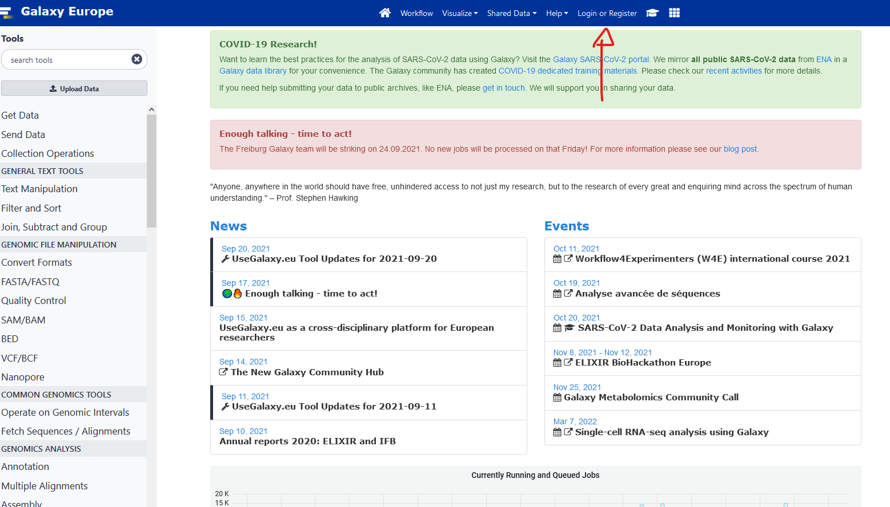
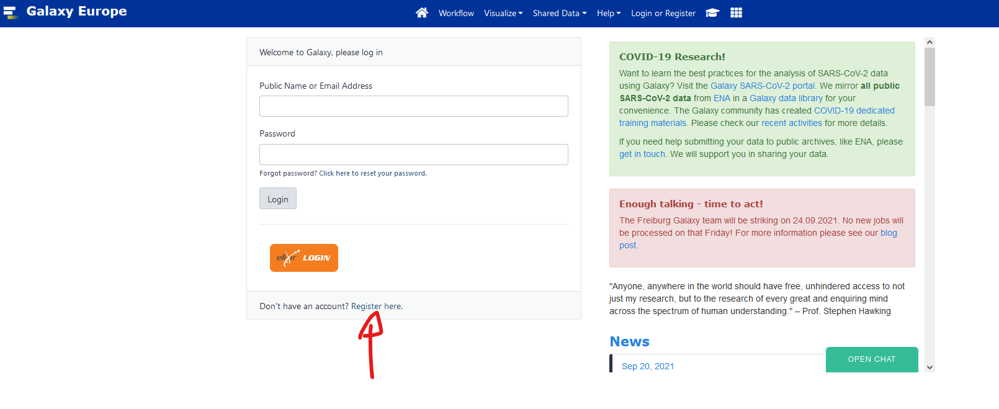
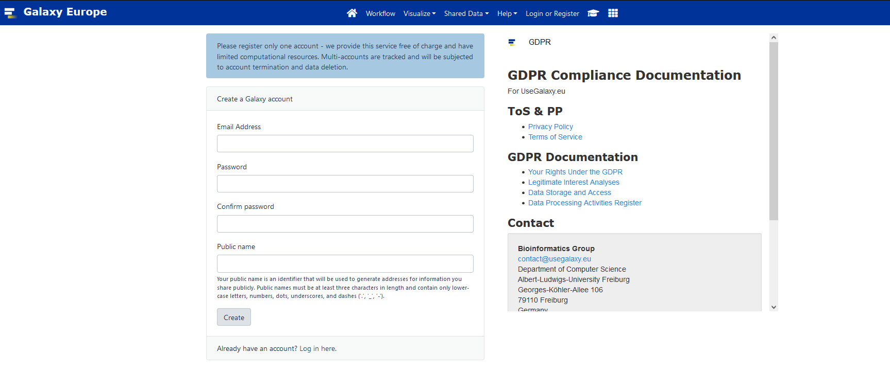
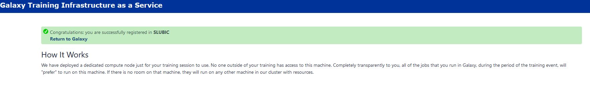

## Introduction

[https://usegalaxy.eu/join-training/heh-mag2025](https://usegalaxy.eu/join-training/heh-mag2025/)

1. Introduction to Galaxy [here](https://training.galaxyproject.org/training-material/topics/introduction/tutorials/galaxy-intro-short/tutorial.html) 
2. Introduction to Metagenomics and environmental studies [Slides 1](slides/intro_to_metagenomics.pdf) [Slides 2](https://training.galaxyproject.org/training-material/topics/metagenomics/slides/introduction.html#1)
3. [The global presentation](slides/Metagenomics_global_RVanDamme.pdf)
4. Muffin A nextflow Genomic Workflow [Slides](slides/MUFFIN_genomic_workflow.pdf)

### Additional Introductions:

* Link to all [Galaxy Metagenomics courses](https://training.galaxyproject.org/training-material/topics/metagenomics/)
* Ancient DNA and metagenomics [Slides](slides/Ancient_metagenomics.pdf)

## Shotgun metagenomics (assembly free)

[Slides](slides/shotgun_metagenomics.pdf)

Assembly-free method, [Practical 4h](tutorials/d1-read-taxonomy.qmd)

### Galaxy alternative
[Taxonomic Profiling and Visualization of Metagenomic Data 2h](https://training.galaxyproject.org/training-material/topics/microbiome/tutorials/taxonomic-profiling/tutorial.html)

Extra, if time allows: [Identification of the micro-organisms in a beer using Nanopore sequencing 1h](https://training.galaxyproject.org/training-material/topics/microbiome/tutorials/beer-data-analysis/tutorial.html)

## Shotgun metagenomics (with assembly)

Assembly and binning method, [Practical 4h](tutorials/d2-assembly-binning.qmd)

### Galaxy alternative
[Assembly of metagenomic sequencing data 2h](https://training.galaxyproject.org/training-material/topics/microbiome/tutorials/metagenomics-assembly/tutorial.html), then [Binning of metagenomic sequencing data 2h](https://training.galaxyproject.org/training-material/topics/microbiome/tutorials/metagenomics-binning/tutorial.html)

## Amplicon sequencing 

[Slides](slides/Metabarcoding.pdf)

Main route (Galaxy, OTUs): [16S Microbial Analysis with mothur (short) 2h](https://training.galaxyproject.org/training-material/topics/microbiome/tutorials/mothur-miseq-sop-short/tutorial.html)

Then (Galaxy, ASVs): [Building an amplicon sequence variant (ASV) table from 16S data using DADA2 3h](https://training.galaxyproject.org/training-material/topics/microbiome/tutorials/dada-16S/tutorial.html)

### alternatives
Local:
[DADA2](tutorials/d2-amplicon-dada2.qmd)

Extra, if time allows (Galaxy):
[16S Microbial analysis with Nanopore data 2h](https://training.galaxyproject.org/training-material/topics/microbiome/tutorials/nanopore-16S-metagenomics/tutorial.html)

## Metatranscriptomics

[Metatranscriptomics analysis using microbiome RNA-seq data (short) 3h](https://training.galaxyproject.org/training-material/topics/microbiome/tutorials/metatranscriptomics-short/tutorial.html)

All the Galaxy tutorials of the course, and how they relate to the local tutorials, are on the [Galaxy route](galaxy.qmd) page.

# Grade breakdown

* 40% Active participation
* 20% Project report
* 40% Pre-Project presentation and discussion

# Project 

## instructions:

Find a tool, pipeline, or analysis method of metagenomics that has not been seen during the course and test and evaluate it.
You must explain how it works, how you found it, and its use in metagenomics studies.
You can compare it to a similar tool/method seen during the course.

You are tasked to have a report of at least two pages (not counting graphics, pictures, and tables).
Additional points will be provided if your work is easily reproducible (scripts, command list, and workflows provided in addition to the report).

## Project Grade breakdown

* 10% originality
* 20% Reasoning and Explanation of what it should do
* 30% execution and testing
* 20% analysis of the results
* 20% comparison to existing methods

## Presentation Plan 
You will present your individual project and a summary of the course.

**15 minutes** of group presentation where you summarise the principles and methods of metagenomics.

**15 minutes** of individual presentation where you expose your work:

* Methods selected and Why
  
* Results
  
* Discussion (comparison with a method seen during the course)

# Bibliography and ressources

Core Papers: 

* [https://www.microbiologyresearch.org/content/journal/mgen/10.1099/mgen.0.000409](https://www.microbiologyresearch.org/content/journal/mgen/10.1099/mgen.0.000409)

* [https://www.nature.com/articles/nbt.3935/figures/1](https://www.nature.com/articles/nbt.3935/figures/1)

* [https://www.sciencedirect.com/topics/biochemistry-genetics-and-molecular-biology/metagenomics](https://www.sciencedirect.com/topics/biochemistry-genetics-and-molecular-biology/metagenomics)

* [https://doi.org/10.1371/journal.pone.0057923](https://doi.org/10.1371/journal.pone.0057923)

Additional read: 

* [https://www.nature.com/articles/nbt.3935](https://www.nature.com/articles/nbt.3935)

* [https://www.nature.com/articles/srep01968](https://www.nature.com/articles/srep01968)

* [https://www.frontiersin.org/articles/10.3389/fmicb.2021.613791/full](https://www.frontiersin.org/articles/10.3389/fmicb.2021.613791/full)

* [https://academic.oup.com/bib/article/22/6/bbab330/6358409](https://academic.oup.com/bib/article/22/6/bbab330/6358409)

* [https://academic.oup.com/bib/article/21/2/584/5363831](https://academic.oup.com/bib/article/21/2/584/5363831)

* [https://www.nature.com/articles/s42003-021-02510-6](https://www.nature.com/articles/s42003-021-02510-6)

* [https://bmcbioinformatics.biomedcentral.com/articles/10.1186/s12859-020-03667-3](https://bmcbioinformatics.biomedcentral.com/articles/10.1186/s12859-020-03667-3)

Tools:

* MUFFIN: [https://github.com/RVanDamme/MUFFIN](https://github.com/RVanDamme/MUFFIN) & [https://journals.plos.org/ploscompbiol/article?id=10.1371/journal.pcbi.1008716](https://journals.plos.org/ploscompbiol/article?id=10.1371/journal.pcbi.1008716)

* metaWRAP: [https://github.com/bxlab/metaWRAP](https://github.com/bxlab/metaWRAP) & [https://microbiomejournal.biomedcentral.com/articles/10.1186/s40168-018-0541-1](https://microbiomejournal.biomedcentral.com/articles/10.1186/s40168-018-0541-1)

* Flye: [https://github.com/fenderglass/Flye](https://github.com/fenderglass/Flye) & [https://www.nature.com/articles/s41592-020-00971-x](https://www.nature.com/articles/s41592-020-00971-x)

* Kraken2: [https://github.com/DerrickWood/kraken2](https://github.com/DerrickWood/kraken2) & [https://genomebiology.biomedcentral.com/articles/10.1186/s13059-019-1891-0](https://genomebiology.biomedcentral.com/articles/10.1186/s13059-019-1891-0)

# Galaxy

## Galaxy set up

1. Register to [usegalaxy.eu](http://usegalaxy.eu/).

2. Click the verification link you will receive by email.

3. Go to this [https://usegalaxy.eu/join-training/heh-mag2025/](https://usegalaxy.eu/join-training/heh-mag2025/) to join our training session. 
It should say you successfully registered in heh-mag2025

## Galaxy introduction

Slides [here](https://training.galaxyproject.org/training-material/topics/introduction/tutorials/galaxy-intro-short/slides.html#1)

We will follow this [tutorial](https://training.galaxyproject.org/training-material/topics/introduction/tutorials/galaxy-intro-short/tutorial.html)

# Local setup

The local tutorials need a set of tools, installed with Pixi. Follow the [Setup](setup.qmd) page.
