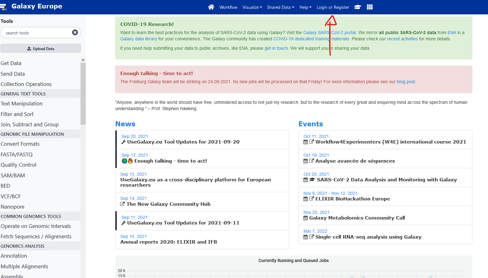
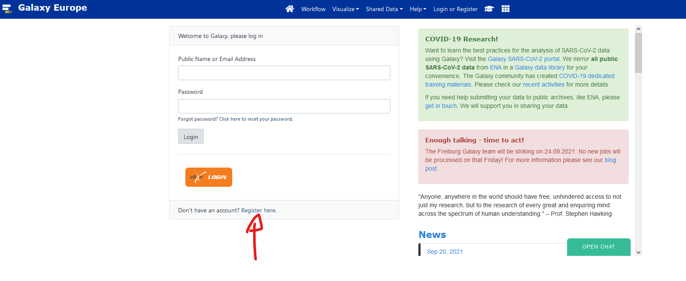
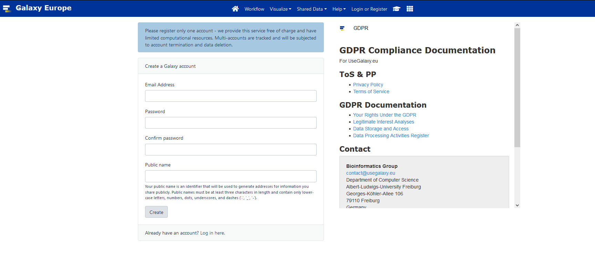
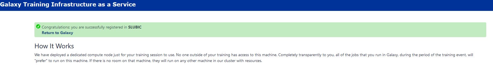

We do the setup together in class on Day 1. This page is the reference.

## What you need

- A laptop with **at least 8 GB of memory (RAM)** and **50 GB of free disk space**.
- Windows 10 or 11 with WSL (Ubuntu), or Linux, or macOS.
- An internet connection for the first installation (about 3 GB of downloads for the tools).

The local tutorials run in a Linux terminal: the Ubuntu terminal of WSL on Windows, or the Terminal on Linux and macOS.

## Windows: WSL

The local tutorials run in **WSL 2** (Windows Subsystem for Linux) with Ubuntu.
If WSL is not installed yet: open **PowerShell as administrator**, run the command below, and restart the computer.

```powershell
wsl --install
```

Then open "Ubuntu" from the Start menu and choose a user name and a password.

### Give WSL 6 GB of memory {#wsl-memory}

The tutorials need **6 GB of memory inside Linux**. By default, WSL gets half of the memory of the computer:

| Memory of the laptop | WSL gets by default | What to do |
|---|---|---|
| 16 GB or more | 8 GB | nothing |
| 12 GB | 6 GB | nothing |
| 8 GB | 4 GB | **set it to 6 GB (below)** |

First check what you have. In the Ubuntu terminal:

```bash
free -h
```

Look at the `total` column of the `Mem:` line. If it shows less than about `5.7Gi`, change the setting:

1. Open **PowerShell** (not Ubuntu) and open the WSL settings file in Notepad. Answer "Yes" if Notepad asks to create the file.

    ```powershell
    notepad "$env:USERPROFILE\.wslconfig"
    ```

2. Write these two lines in the file, save it and close Notepad.

    ```ini
    [wsl2]
    memory=6GB
    ```

3. Stop WSL, still in PowerShell. This closes all your Ubuntu terminals.

    ```powershell
    wsl --shutdown
    ```

4. Open Ubuntu again and run `free -h`. The total is now about `5.8Gi`.

::: {.callout-warning}
On a laptop with 8 GB, this leaves only 2 GB for Windows. During the long steps (Kraken 2, assembly, CheckM), close
the other Windows programs, the web browser first.
:::

## 1. Install Pixi

[Pixi](https://pixi.sh) installs the tools of the course, in the same versions for everybody.

```bash
curl -fsSL https://pixi.sh/install.sh | sh
```

Close the terminal and open a new one. Then check that Pixi answers:

```bash
pixi --version
```

## 2. Get the course folder

Everything of the course goes in one folder, `~/mag2026`, inside your home (`~`):

| Folder | Content |
|---|---|
| `~/mag2026/Metagenomics_course` | the course folder: the list of tools and the tools themselves |
| `~/mag2026/databases` | the reference databases (Kraken 2, CheckM, CheckM2, sourmash) |
| `~/mag2026/d1` | your work of Day 1, in `data/` and `results/` |
| `~/mag2026/d2` | your work of Day 2, in `data/` and `results/` |

The tutorials create the folders `databases`, `d1` and `d2` when they are needed. Now create the first one:

```bash
mkdir -p ~/mag2026
cd ~/mag2026
git clone https://github.com/RVanDamme/Metagenomics_course.git
```

::: {.callout-warning}
On Windows, stay inside the Linux home (`~`). Do not work in `/mnt/c/...` (the Windows drive): the tools are very slow there.
:::

## 3. Install the tools

```bash
cd ~/mag2026/Metagenomics_course
pixi install --all
```

This downloads and installs every tool the local tutorials need (about 12 GB on disk once installed).
The versions are fixed by the files `pixi.toml` and `pixi.lock` of the course folder.

The tools are grouped in **environments**:

| Environment | Tools | Used in |
|---|---|---|
| main (no name needed) | FastQC, fastp, MultiQC, Kraken 2, Bracken (Linux), KrakenTools, Krona, sickle, MEGAHIT, Bowtie 2, samtools, MetaBAT 2, sourmash, seqkit | Day 1 and Day 2 |
| `checkm1` | CheckM 1 | Day 2, quality of the bins |
| `checkm2` | CheckM2 | Day 2, quality of the bins |
| `prokka` | Prokka | Day 2, annotation |
| `bracken-mac` | Bracken (macOS only) | Day 1 |

## 4. Check your setup

```bash
cd ~/mag2026/Metagenomics_course
pixi run check
```

The check lists every tool, the memory, the free disk space and the place of the course folder.
Each line starts with `OK`, `WARNING` or `PROBLEM`. A `PROBLEM` line tells you what to do.
When the last line says "Everything is ready", you are done.

## 5. Start a work session

Each time you open a new terminal for a tutorial, activate the main environment:

```bash
cd ~/mag2026/Metagenomics_course
pixi shell
```

Your prompt now starts with `(mag-2026)`. Go to your working folder and follow the tutorial.
To leave the environment, type `exit`.

For a step that uses another environment, open a **second terminal** and give the name of the environment:

```bash
cd ~/mag2026/Metagenomics_course
pixi shell -e checkm1
```

## macOS with Apple Silicon (M1 and later): Rosetta

Two tools of the course have no version for Apple Silicon processors:

- **Prokka** (environment `prokka`);
- **Bracken** (environment `bracken-mac`).

Both environments use the Intel version of the tools. macOS runs Intel programs through **Rosetta 2**.
Install Rosetta once, **before** `pixi install --all`:

```bash
softwareupdate --install-rosetta --agree-to-license
```

After that, you use these environments like any other. Pixi sees that the environment exists only for Intel Macs
and starts it through Rosetta:

```bash
cd ~/mag2026/Metagenomics_course
pixi shell -e prokka
```

Inside this environment the command `uname -m` answers `x86_64` (Intel) instead of `arm64`. This is expected.
Tools run a little slower under Rosetta than native tools.

On a Mac with an Intel processor you do not need Rosetta: the same environments run directly.

::: {.callout-note}
Linux and Windows (WSL) users have nothing to do here: Prokka and Bracken are installed with the other tools.
:::

## Galaxy account

1. Register to [usegalaxy.eu](http://usegalaxy.eu/).







2. Click the verification link you will receive by email.

3. Go to this [https://usegalaxy.eu/join-training/heh-mag2025/](https://usegalaxy.eu/join-training/heh-mag2025/) to join our training session. 
It should say you successfully registered in heh-mag2025



### Introduction to Galaxy

Slides [here](https://training.galaxyproject.org/training-material/topics/introduction/tutorials/galaxy-intro-short/slides.html#1)

We will follow this [tutorial](https://training.galaxyproject.org/training-material/topics/introduction/tutorials/galaxy-intro-short/tutorial.html)

## R and RStudio

The amplicon tutorial (DADA2) runs in [RStudio](https://posit.co/download/rstudio-desktop/), installed on your own
system (Windows, macOS or Linux), not inside WSL. Install [R](https://cloud.r-project.org/) first, then RStudio.
The tutorial page lists the R packages to install.

## Troubleshooting

### "HTTP error" or "could not resolve host" in WSL {#wsl-network}

Sometimes WSL loses its connection to the internet, and `pixi install`, `curl` or `git clone` stop with an HTTP or
"could not resolve host" error. The usual cause is the network or DNS setting of WSL, not the tool.
Try these steps in order, and test after each one.

**Test.** In the Ubuntu terminal, this command must print an address:

```bash
getent hosts conda.anaconda.org
```

**Step 1: restart WSL.** In PowerShell, run `wsl --shutdown`, then open Ubuntu again.
If that is not enough, restart the computer.

**Step 2 (Windows 11): use the network of Windows.** Open the WSL settings file from PowerShell with
`notepad "$env:USERPROFILE\.wslconfig"` and add the two network lines under `[wsl2]`.
Keep the `memory` line if you have one.

```ini
[wsl2]
networkingMode=mirrored
dnsTunneling=true
```

Save, run `wsl --shutdown` in PowerShell, open Ubuntu again and repeat the test.
This setting needs Windows 11 version 22H2 or later. It also helps when a VPN is active.

**Step 3 (last resort): set the DNS server by hand.** Ask your teacher before you do this.

1. In Ubuntu, open the WSL configuration with `sudo nano /etc/wsl.conf` and add:

    ```ini
    [network]
    generateResolvConf = false
    ```

2. In PowerShell, run `wsl --shutdown`, then open Ubuntu again.
3. In Ubuntu, write a public DNS server in the DNS file:

    ```bash
    sudo rm -f /etc/resolv.conf
    echo "nameserver 1.1.1.1" | sudo tee /etc/resolv.conf
    ```

### A warning about "post-link scripts" during `pixi install`

Pixi does not run the small scripts that some packages (here Krona) would like to run after their installation, and it tells you so. This warning is harmless: the tools of the course work without these scripts.

### FastQC prints "usage: fastqc …" and stops when you use `-o`

Recent versions of FastQC no longer accept the short option `-o` for the output folder. Use the long form, as in the tutorials: `fastqc --outdir results/fastqc ...`.

### A step is "Killed" or stops without a message

The step probably needed more memory than Linux has. Check the memory with `free -h` and see
[Give WSL 6 GB of memory](#wsl-memory). Close other programs and run the step again.
